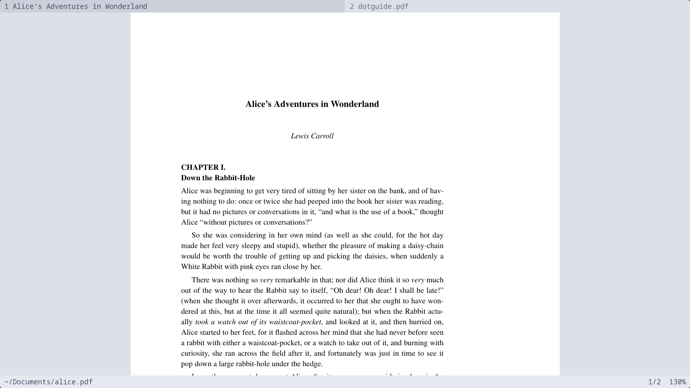

<p align="center"></p>

# pdvim

A keyboard-driven PDF reader with vi keys. pdvim also reads EPUB and FB2 books, CBZ comics, XPS documents, SVG drawings and images.

pdvim renders pages with [MuPDF](https://mupdf.com/) and draws its window with [iced](https://iced.rs/). Pages run in one continuous column, up to four side by side, or a page or two facing pages at a time. pdvim remembers where you stopped in every document.



## What it does

- **Moves like vi.** `j` / `k`, `gg` / `G`, counts such as `12G` and `50%`, `}` / `{` from paragraph to paragraph, marks (`ma`, `` `a ``), a jump list (`Ctrl-o` / `Ctrl-i`), and `.` to repeat a command.
- **Searches like vim.** `/` and `?` with smartcase, `n` / `N`, `*` / `#` for the selection, and `g /` to list every match with its line, like the quickfix list.
- **Needs no mouse, but takes one.** `f` puts a label on every link and form field in view. Type a label to follow the link or fill in the field. `yi` does the same for pictures and figures, to copy one as an image. A click follows a link too, and a drag selects text.
- **Selects text like vim.** `v` and `V` start a selection at a labelled line, and `w`, `e`, `f`, `iw`, `is`, `ip` and the other motions grow it; `gv` selects it again. Copy the selection as running text, with the PDF's line breaks and hyphens taken out, or highlight, underline, strike out or squiggle it.
- **Saves standard annotations.** Highlights and notes go into the PDF when you save with `:w`, so other readers show them too. `u` undoes them.
- **Reads well at night.** Recolors pages to suit a dark theme, and follows the system's light or dark setting. The four [Catppuccin](https://catppuccin.com) flavors are built in. It can also trim blank margins.
- **Finds its way around.** A table of contents sidebar, guessed from the text when a PDF has none, `]]` / `[[` from chapter to chapter, a grid of every page with `go`, and printed page numbers such as `xii`.
- **Also has** tabs, sessions that open them again, a list of recent documents, password-protected PDFs, fillable forms, `:!` shell commands, `:export` to PNG or SVG, and its manual inside it with `:man`.
- **Is configured in one file.** A TOML file holds settings and key bindings for every mode. Settings can differ by path, and keys can run command lines.

## Screenshots

The table of contents, in the Catppuccin Mocha theme, with the page recolored to match:


Visual mode starts from a line picked by its label:


A highlight, an underline, a squiggly underline, and a selection in progress:


`:help` lists every key binding in force:


## Installing

Each [release](https://github.com/djmbritt/pdvim/releases) has packages for:

| Platform             | Download                                                                                             |
| -------------------- | ---------------------------------------------------------------------------------------------------- |
| Linux, x86-64        | `pdvim_VERSION-1_amd64.deb`, or `pdvim-VERSION-x86_64-unknown-linux-gnu.tar.gz`                      |
| Linux, x86-64        | `pdvim-VERSION-x86_64.AppImage`, or `pdvim-VERSION-x86_64.flatpak` for `flatpak install --user`      |
| Linux, Arm 64-bit    | `pdvim_VERSION-1_arm64.deb`, or `pdvim-VERSION-aarch64-unknown-linux-gnu.tar.gz`                     |
| Linux, Arm 64-bit    | `pdvim-VERSION-aarch64.AppImage`, or `pdvim-VERSION-aarch64.flatpak` for `flatpak install --user`    |
| Fedora, openSUSE     | `pdvim-VERSION-1.x86_64.rpm`, or `pdvim-VERSION-1.aarch64.rpm` on Arm, for `sudo dnf install ./FILE` |
| Arch Linux           | `makepkg -si` in [`packaging/`](packaging/), which builds what is checked out                        |
| Nix                  | `nix run github:djmbritt/pdvim`, or `nix profile add github:djmbritt/pdvim`                          |
| macOS                | `brew install djmbritt/pdvim/pdvim`, from the [Homebrew tap](packaging/homebrew/)                    |
| macOS, Apple silicon | `pdvim-VERSION-aarch64-apple-darwin.dmg`, or the `.tar.gz` for the terminal                          |
| macOS, Intel         | `pdvim-VERSION-x86_64-apple-darwin.dmg`, or the `.tar.gz`                                            |
| Windows, x86-64      | `pdvim-VERSION-x86_64-pc-windows-msvc.zip`                                                           |

The packages install the manual pages too: `man pdvim` covers the keys and commands, and `man 5 pdvim` covers the configuration file.

On Debian, Ubuntu, Fedora and openSUSE, the [package repository](https://djmbritt.github.io/pdvim/) keeps pdvim up to date with the rest of the system. On Debian and Ubuntu:

```sh
sudo install -d /etc/apt/keyrings
sudo curl -fsSLo /etc/apt/keyrings/pdvim.gpg https://djmbritt.github.io/pdvim/pdvim.gpg
sudo curl -fsSLo /etc/apt/sources.list.d/pdvim.sources https://djmbritt.github.io/pdvim/pdvim.sources
sudo apt update && sudo apt install pdvim
```

On Fedora:

```sh
sudo curl -fsSLo /etc/yum.repos.d/pdvim.repo https://djmbritt.github.io/pdvim/pdvim.repo
sudo dnf install pdvim
```

### Building from source

pdvim needs Rust 1.90 or newer. The `mupdf` crate builds MuPDF from source, so you also need a C toolchain and `libclang`. With Nix, `nix develop` opens a shell that has them, and `nix build` builds the package.

```sh
cargo build --release
```

The binary is written to `target/release/pdvim`.

## Getting started

```sh
pdvim paper.pdf book.epub   # each file opens in a tab of its own
pdvim                       # pick from the documents you read last
```

Some keys to try first:

- `j` / `k` scroll, `J` / `K` turn the page, and `gg` / `G` go to the first or last page.
- `Tab` opens the table of contents, and `go` shows every page small.
- `/` searches, and `n` / `N` go to the next or previous match.
- `f` follows a link by its label.
- `v` selects text. Then `y` copies it, or `H` highlights it. `:w` saves the highlights into the file.
- `:help` lists every key, `:man` opens the manual, and `q` closes the tab.

Put a count before a key to repeat it, as in vi: `3j` scrolls three steps, and `12G` goes to page 12. `Esc` cancels a key sequence you have half typed.

## Keys

These are the default keys. `:help` shows the keys bound right now, and `man pdvim` describes each one in full.

### Moving

| Key                                         | Action                                                |
| ------------------------------------------- | ----------------------------------------------------- |
| `j` / `k` / `h` / `l`, arrow keys           | Scroll down / up / left / right                       |
| `Ctrl-d` / `Ctrl-u`                         | Scroll half a screen down / up                        |
| `Ctrl-f`, `Space` / `Ctrl-b`, `Shift-Space` | Scroll a full screen down / up                        |
| `J`, `PageDown` / `K`, `PageUp`             | Go to the next / previous page                        |
| `gg`, `Home` / `G`, `End`                   | Go to the first / last page, or page _n_ with a count |
| `{n}%`                                      | Go _n_ percent of the way through the document        |
| `H` / `L`                                   | Go to the top / bottom of the page                    |
| `}` / `{`                                   | Bring the next / previous paragraph to the top        |
| `]]` / `[[`                                 | Go to the next / previous chapter                     |
| `Tab`                                       | Show the table of contents                            |
| `go`                                        | Show every page small, to pick one                    |
| `m{a-z}` / `m{A-Z}`                         | Mark this place in this document / for any document   |
| `` `{letter} ``, `'{letter}`                | Go to a mark                                          |
| `Ctrl-o` / `Ctrl-i`                         | Go back / forward through the jumps                   |

A jump is `gg`, `G`, `%`, a paragraph, a search match, a chapter, a followed link or a mark. `:marks` lists the marks, which are kept after pdvim closes.

The table of contents moves with `j` / `k`, and `l` / `h` open and close a chapter's sections. A PDF without one gets one guessed from its text: from a printed contents page, or else from the headings, told by their larger or bold type. The page grid moves with `h` `j` `k` `l`. In both, `Enter` goes to the item selected, and `Esc` or `q` goes back. Going somewhere this way counts as a jump, so `Ctrl-o` brings you back.

### Viewing

| Key                   | Action                                                                |
| --------------------- | --------------------------------------------------------------------- |
| `+`, `zi` / `-`, `zo` | Zoom in / out                                                         |
| `=`, `z0`             | Zoom to 100%, or to _n_% with a count                                 |
| `zw` / `zp`           | Fit the page's width / the whole page                                 |
| `r`                   | Rotate                                                                |
| `R`                   | Turn recoloring on or off                                             |
| `t`                   | Turn margin trimming on or off                                        |
| `zc`                  | Show two pages side by side, or one                                   |
| `zm`                  | Show pages continuously, one at a time, or two facing pages at a time |
| `zf`                  | Draw a line round every page, or stop                                 |
| `zb`                  | Hide the tab and status bars, or show them                            |
| `F11`                 | Fill the screen, or stop                                              |

### Searching and commands

| Key       | Action                                            |
| --------- | ------------------------------------------------- |
| `/` / `?` | Search forwards / backwards                       |
| `n` / `N` | Go to the next / previous match                   |
| `g /`     | List every match with its line, to go to one      |
| `:`       | Open the command prompt                           |
| `.`       | Run the last command line again                   |
| `o`       | Show the documents you read recently              |
| `Ctrl-g`  | Show the document's title, author, dates and more |
| `Esc`     | Cancel, and hide the search highlights            |
| `q`       | Close the tab, and quit after the last one        |

A search matches case only when what you type has a capital letter in it, as vim's `smartcase`. Matches are highlighted while you type a search. At the `:` prompt, the commands that fit what you type are listed as you type, under a line saying what the command does. `Tab` completes commands, settings and file paths, and `Up` / `Down` bring back earlier commands and searches. That history is kept after pdvim closes.

### Links and forms

| Key  | Action                                                  |
| ---- | ------------------------------------------------------- |
| `f`  | Label every link, form field and marking in view        |
| `F`  | Label the links, and open the one you pick in a new tab |
| `;y` | Label the links, and copy where the one you pick goes   |
| `gi` | Fill in the first form field in view                    |
| `g;` | Go back to the form field you were in last              |

Type a label to pick its link or field. Web and mail links open in your default program. Picking a text field lets you type into it on the page, and `Tab` goes on to the next field. Checkboxes tick and lists drop down. After any key that shows labels, `/` and some text narrows the labels to the items that hold it.

### Selecting text

`v` selects characters and `V` selects whole lines. Each line in view gets a label, and so does each picture and figure: typing a line's label starts the selection there, and a figure's selects that figure as a box. `I` labels only the pictures and figures, in normal mode, visual mode or while the lines are labelled. `s` puts just a cursor at the text you type instead, which moves without selecting until `v` or `V` starts a selection from it; while selecting, `s` moves the cursor to the text, as [flash.nvim](https://github.com/folke/flash.nvim) does.

| Key in visual mode         | Action                                                     |
| -------------------------- | ---------------------------------------------------------- |
| `h` `j` `k` `l`            | Move the cursor a character or a line                      |
| `w` / `b` / `e`            | Move to the next word / the word before / the word's end   |
| `0` / `^` / `$`            | Move to the start / the first letter / the end of the line |
| `f` `F` `t` `T`, `;` / `,` | Move to a character on the line, and repeat that           |
| `iw` / `aw`                | Select the word, or the word and the space after it        |
| `is` / `as`                | Select the sentence, or the sentence and the space after   |
| `ip` / `ap`                | Select the paragraph                                       |
| `I`                        | Label the pictures and figures, to select one              |
| `*` / `#`                  | Search forward / backward for the selection                |
| `o`                        | Move to the other end of the selection                     |
| `y`                        | Copy the selection, or a figure selected as an image       |
| `H` / `U` / `S` / `W`      | Highlight / underline / strike out / squiggle it           |
| `n`                        | Put a note beside the line                                 |
| `c` / `d`                  | Change the note on a marking / take markings away          |
| `Esc`                      | Leave without copying                                      |

Pressed again, or after a count, `iw`, `is` and `ip` take in the next words, sentences or paragraphs. A picture or figure selected with `I` shows as a box: `y` copies it as an image, `H` / `U` / `S` / `W` mark its area, and a motion goes back to selecting text from the cursor. In normal mode, `gv` selects the last selection again. The status bar always lists what you can do next.

### Highlights and notes

| Key              | Action                                                   |
| ---------------- | -------------------------------------------------------- |
| `]h` / `[h`      | Go to the next / previous marking                        |
| `gh`             | Label the markings in view, to pick one                  |
| `d` / `c` / `yh` | Take away / change the note on / copy the marking picked |
| `Shift-Tab`      | List every marking in a sidebar                          |
| `u` / `Ctrl-r`   | Undo / redo                                              |
| `Ctrl-s`, `:w`   | Save the markings into the file                          |

Nothing is written until you save. Until then the tab shows `[+]`, and pdvim asks before closing the document. `:w copy.pdf` saves a copy instead, and the `autosave` setting saves each change as you make it. `:note {text}` puts a sticky note at the top of the window.

### Copying

| Key  | Action                                                  |
| ---- | ------------------------------------------------------- |
| `yy` | Copy the path of the document's file                    |
| `yt` | Copy the document's title                               |
| `yp` | Copy the text of the page in view                       |
| `yi` | Label the pictures and figures, to copy one as an image |

Text is copied as running text: the lines of a paragraph are joined with spaces, a word broken over two lines with a hyphen is made whole, and paragraphs are kept apart by a blank line.

### Mouse

| Mouse                                     | Action                                                              |
| ----------------------------------------- | ------------------------------------------------------------------- |
| Wheel, `Ctrl`-wheel                       | Scroll, zoom                                                        |
| Click                                     | Follow a link or fill in a form field; elsewhere, end the selection |
| Drag over text                            | Select it, as in visual mode, to copy with `y`                      |
| Double click                              | Select a word                                                       |
| Middle drag, or a drag from off the pages | Move the pages                                                      |
| Click in a list                           | Go to the tab, document, chapter, marking, match or page clicked    |

The `wheel-speed` setting makes the wheel and touchpad scroll faster or slower.

### Tabs

| Key                                       | Action                                    |
| ----------------------------------------- | ----------------------------------------- |
| `gt`, `Ctrl-Tab` / `gT`, `Ctrl-Shift-Tab` | Go to the next / previous tab, or tab _n_ |
| `b`                                       | List the tabs, and type to find one       |
| `U`                                       | Open the tab you closed last again        |

### Modes

The box at the left of the status bar always names the mode. Modes of the same kind share a color:

| Color  | Modes                                                                                            |
| ------ | ------------------------------------------------------------------------------------------------ |
| Blue   | `NORMAL`: reading                                                                                |
| Mauve  | `VISUAL`, `V-LINE`, `SELECT`, `JUMP`: selecting text                                             |
| Green  | `INSERT`: filling in a form field                                                                |
| Peach  | `COMMAND`, `SEARCH`, `PASSWORD`, `CONFIRM`: typing or answering at the bottom                    |
| Yellow | `FOLLOW`, `PICK`: labels on links, fields, markings and figures                                  |
| Teal   | `CONTENTS`, `OVERVIEW`, `MARKINGS`, `HELP`, `RECENT`, `TABS`, `MATCHES`, `INFO`: a list or panel |

## Commands

| Command                                | Action                                                       |
| -------------------------------------- | ------------------------------------------------------------ |
| `:{n}`, `:goto {label}`                | Go to page _n_, or to the page numbered `xii` or `A-3`       |
| `:o[pen] {file}`, `:tabe[dit] {file}`  | Open a document in a new tab                                 |
| `:rec[ent]`                            | Show the documents you read recently                         |
| `:w[rite]`, `:w {file}`                | Save the markings, or save a copy with them                  |
| `:q[uit]`, `:qa[ll]`, `:wq`, `:q!`     | Close the tab or quit, saving first or throwing changes away |
| `:tabn[ext]`, `:tabp[revious]`         | Go to the next or previous tab                               |
| `:tabc[lose]`, `:tabo[nly]`            | Close this tab, or every other one                           |
| `:tabm[ove] [n\|+n\|-n]`               | Move the tab                                                 |
| `:note {text}`                         | Put a note in the margin at the top of the window            |
| `:marks`, `:delm[arks] {letters}`      | List marks, or take them away                                |
| `:info`                                | Show the title, author, dates, pages and encryption          |
| `:export[!] {file}`                    | Save the page in view as a `.png` image or an `.svg` drawing |
| `:!{command}`                          | Run a shell command; `%` stands for the document's file      |
| `:set {setting} {value}`               | Change a [setting](#settings)                                |
| `:theme {name}`                        | Change the theme, or show it without a name                  |
| `:map`, `:unmap`, `:mapclear`          | Change the [key bindings](#key-bindings)                     |
| `:so[urce] [file]`                     | Read the configuration file again                            |
| `:h[elp] [topic]`, `:apr[opos] {word}` | Show the keys: all of them, or those about a topic or word   |
| `:man [5]`                             | Open the manual, or the configuration's, in a tab            |
| `:ve[rsion]`                           | Show pdvim's version                                         |

Any action can also be run by name, such as `:next-tab` or `:zoom-to 150`. Separate several commands with `;`. For example, `:!xdg-open %` opens the document in your default program, and `:!cp % ~/papers/` copies it.

## Books, comics and images

Besides PDF, pdvim opens EPUB and FB2 books, CBZ and CBT comics, XPS documents, SVG drawings, and PNG, JPEG, GIF, TIFF, BMP and other images.

A book has no pages of its own, so pdvim lays it out on pages the size of the window, in the type size `fontsize` sets. In a book, the zoom keys make the type bigger or smaller. When the window changes, the book is laid out again, and you stay at the same passage.

Search, copying, links, the table of contents and visual mode work in every format that has text. Highlights, notes, forms and `:w` work in PDFs only.

## Configuration

pdvim reads `~/.config/pdvim/config.toml` when it starts, or the same path under `$XDG_CONFIG_HOME` when that is set. You don't need the file. After you edit it, `:source` reads it again.

[`defaults.toml`](defaults.toml) lists every setting and every key binding of every mode, with comments. pdvim reads it before your file. Copy it to start from:

```sh
mkdir -p ~/.config/pdvim
cp defaults.toml ~/.config/pdvim/config.toml
```

A short file works too, since anything you leave out keeps its default:

```toml
[settings]
recolor = true
theme = "catppuccin-macchiato"
scroll-step = 60

[keys.normal]
"ctrl+n" = "next-tab"
"ctrl+p" = "previous-tab"
"ctrl+t" = ":theme catppuccin-latte"

[keys.visual]
"Y" = "yank"
```

If an entry has a mistake, pdvim skips it and shows the mistake in the status bar.

### Settings

`:set` takes the same names and values while pdvim runs. A boolean setting named without a value is turned on.

| Setting                                    | Default                                 | What it does                                                               |
| ------------------------------------------ | --------------------------------------- | -------------------------------------------------------------------------- |
| `recolor`                                  | `"auto"`                                | Recolor pages for a dark background: `true`, `false`, or follow the system |
| `trim`                                     | `false`                                 | Hide the blank margins of pages, each enlarged to fill the width alike     |
| `theme`                                    | `"auto"`                                | The theme, or `"auto"` to follow the system                                |
| `theme-dark` / `theme-light`               | `catppuccin-mocha` / `catppuccin-latte` | The themes `"auto"` uses                                                   |
| `recolor-lightcolor` / `recolor-darkcolor` | `"theme"`                               | The colors paper and ink become when recolored, as `#rrggbb`               |
| `scroll-step`                              | `40`                                    | How far `j` and `k` scroll, in pixels                                      |
| `wheel-speed`                              | `1`                                     | How fast the wheel and touchpad scroll, times their usual speed            |
| `fontsize`                                 | `12`                                    | The type size of books, in points                                          |
| `columns`                                  | `1`                                     | How many pages sit side by side, 1 to 4                                    |
| `page-mode`                                | `"continuous"`                          | `continuous`, `single` (a page at a time) or `double` (two facing pages)   |
| `page-borders`                             | `false`                                 | Draw a line round every page                                               |
| `backdrop`                                 | `"theme"`                               | Behind the pages, the theme's color, or `"paper"`: the pages' own color    |
| `autosave`                                 | `false`                                 | Save each marking into the file as soon as it is made                      |
| `confirm-quit` / `confirm-tab-close`       | `true`                                  | Ask before quitting / before closing a tab                                 |
| `hintchars`                                | `"asdfghjkl"`                           | The letters labels are made of                                             |
| `incsearch`                                | `true`                                  | Highlight matches while a search is typed                                  |
| `smartcase`                                | `true`                                  | Match case when a search has a capital letter in it                        |
| `session`                                  | `false`                                 | Started without a file, open the tabs left open last time                  |
| `tabbar` / `statusbar`                     | `true`                                  | Show the tab bar / the status bar                                          |
| `highlight-color`, `underline-color`       | `#ffff00`, `#1e88e5`                    | The colors of highlights and underlines                                    |
| `strikeout-color`, `squiggly-color`        | `#e53935`, `#fb8c00`                    | The colors of strike-outs and squiggly underlines                          |
| `note-color`                               | `#fdd835`                               | The color of a note's icon                                                 |

The themes are `catppuccin-latte`, `catppuccin-frappe`, `catppuccin-macchiato`, `catppuccin-mocha`, `pdvim-dark` and `pdvim-light`. On Linux, pdvim reads the system's light or dark preference from the desktop portal.

### Settings by path

`[[paths]]` tables give some documents settings of their own. Each one has a pattern under `match`, and any of `recolor`, `trim` and `columns`:

```toml
# Scans stay as printed, and trimmed.
[[paths]]
match = "~/scans/**"
recolor = false
trim = true

# Comics two pages at a time, wherever they are.
[[paths]]
match = "*.cbz"
columns = 2
```

`*` matches any characters except `/`, `?` matches one character, and `**` matches anything, however deep. A pattern without a `/` is matched against the file's name alone. When several rules match, the last one wins.

### Key bindings

Each `[keys.<mode>]` table binds keys to that mode's actions, on top of the defaults. Bind keys to `"none"` to remove a default.

- **Keys** are written as a character (`j`, `G`, `?`) or a name (`space`, `tab`, `escape`, `enter`, `pageup`, `f1`, and so on), with `ctrl+` or `shift+` in front for modifiers: `ctrl+d`, `shift+tab`.
- **Sequences** are keys separated by spaces, as in `"g g"`.
- **Command lines**, written after a `:`, can be bound to keys in normal mode, as in `":set recolor false; zoom-to 150"`.

The modes are `normal`, `visual`, `hints`, `overview`, `outline`, `markings`, `recent`, `help`, `prompt` and `confirm`. `defaults.toml` and `:help` list the actions of each. While pdvim runs, `:map visual Y yank`, `:unmap outline q` and `:mapclear prompt` do the same.

## Files

| What            | Linux                                 | macOS                  | Windows                |
| --------------- | ------------------------------------- | ---------------------- | ---------------------- |
| Configuration   | `~/.config/pdvim/config.toml`         | `~/.config/pdvim`      | `%APPDATA%\pdvim`      |
| Reading history | `~/.local/share/pdvim/history.sqlite` | `~/.local/share/pdvim` | `%LOCALAPPDATA%\pdvim` |

The reading history keeps each document's page, zoom, marks and other state, your command history, and the tabs open when you last quit. `:man` writes the manual pages, as HTML, to a `manual` folder beside it. On Linux, `$XDG_CONFIG_HOME` and `$XDG_DATA_HOME` move these files when they are set.

The Flatpak reads the same configuration, but keeps its history in `~/.var/app/io.github.djmbritt.pdvim`. It can open files in your home folder, `/media`, `/run/media` and `/mnt`.

## Testing

`cargo test` runs the tests: units of each part, and the app itself driven with real PDFs from `fuzz/seeds/`, every key bound by default pressed and every command run, and the window drawn in each of its states with tiny-skia, needing no screen or graphics card. `src/languages.rs` tries the handling of text in sixteen languages, from English to Arabic, Hindi, Chinese and Thai: selecting sentences, copying, searching and moving the cursor, over each sample laid out and as MuPDF reads it from a PDF made of it. The samples are in `fuzz/languages/samples.tsv`, and `fuzz/languages/make-pdfs.sh` makes the PDFs again with Chromium when they change. `coverage.sh` runs them with coverage turned on and prints how much of each file in `src/` they reach. It leaves out `src/main.rs`, which opens the window, and `src/clipboard.rs`, which hands pictures to the system's clipboard, as no test can run them. It needs `llvm-tools` (`rustup component add llvm-tools-preview`), and leaves a report to browse line by line in `target/coverage/html/index.html`. GitHub Actions measures it after every push to `main`, in the run's summary.

```sh
./coverage.sh
```

Measured on 2026-11-23:

<details>
<summary>Lines, functions and regions covered, by file</summary>

| File | Lines | Functions | Regions |
|------|------:|----------:|--------:|
| `src/app.rs` | 81% | 82% | 81% |
| `src/app/bars.rs` | 97% | 83% | 92% |
| `src/app/chapters.rs` | 87% | 100% | 93% |
| `src/app/copy.rs` | 93% | 100% | 94% |
| `src/app/drawing.rs` | 100% | 100% | 100% |
| `src/app/every_key.rs` | 89% | 94% | 90% |
| `src/app/flash.rs` | 92% | 100% | 95% |
| `src/app/forms.rs` | 86% | 96% | 87% |
| `src/app/incsearch.rs` | 95% | 100% | 96% |
| `src/app/info.rs` | 92% | 93% | 93% |
| `src/app/links.rs` | 82% | 87% | 82% |
| `src/app/markings.rs` | 80% | 80% | 79% |
| `src/app/matches.rs` | 94% | 96% | 94% |
| `src/app/mode.rs` | 95% | 100% | 96% |
| `src/app/overview.rs` | 94% | 93% | 95% |
| `src/app/paragraphs.rs` | 98% | 100% | 98% |
| `src/app/pointer.rs` | 85% | 85% | 86% |
| `src/app/reflow.rs` | 77% | 70% | 71% |
| `src/app/run.rs` | 68% | 64% | 71% |
| `src/app/tabs.rs` | 95% | 96% | 95% |
| `src/app/unlock.rs` | 96% | 94% | 96% |
| `src/backend.rs` | 95% | 87% | 93% |
| `src/bench.rs` | 99% | 100% | 98% |
| `src/bindings.rs` | 98% | 100% | 98% |
| `src/command.rs` | 99% | 96% | 99% |
| `src/complete.rs` | 99% | 100% | 98% |
| `src/config.rs` | 93% | 93% | 91% |
| `src/contents.rs` | 99% | 100% | 98% |
| `src/dirs.rs` | 83% | 60% | 78% |
| `src/flash.rs` | 97% | 97% | 99% |
| `src/fonts.rs` | 66% | 78% | 74% |
| `src/fuzz.rs` | 87% | 91% | 90% |
| `src/help.rs` | 99% | 100% | 99% |
| `src/hints.rs` | 96% | 100% | 97% |
| `src/history.rs` | 96% | 98% | 91% |
| `src/input.rs` | 99% | 100% | 99% |
| `src/jumps.rs` | 100% | 100% | 100% |
| `src/keymap.rs` | 100% | 98% | 100% |
| `src/languages.rs` | 93% | 100% | 94% |
| `src/layout.rs` | 99% | 100% | 99% |
| `src/manual.rs` | 90% | 96% | 90% |
| `src/markings.rs` | 97% | 97% | 95% |
| `src/num.rs` | 100% | 100% | 100% |
| `src/outline.rs` | 96% | 98% | 94% |
| `src/overview.rs` | 98% | 93% | 99% |
| `src/paths.rs` | 97% | 100% | 97% |
| `src/picker.rs` | 99% | 100% | 98% |
| `src/prose.rs` | 97% | 100% | 91% |
| `src/reader.rs` | 98% | 99% | 98% |
| `src/recall.rs` | 100% | 100% | 100% |
| `src/recolor.rs` | 100% | 100% | 100% |
| `src/shell.rs` | 78% | 65% | 80% |
| `src/theme.rs` | 61% | 73% | 55% |
| `src/visual.rs` | 97% | 98% | 97% |
| **Total** | **91%** | **92%** | **91%** |

</details>

The parts that draw the window and talk to the system, such as `src/app.rs`'s view, the clipboard and `main.rs`, are reached by using pdvim rather than by its tests, and the fuzz targets reach the document readers further: see [fuzz/README.md](fuzz/README.md).

## Fuzzing

`fuzz/` holds [cargo-fuzz](https://github.com/rust-fuzz/cargo-fuzz) targets for every part of pdvim that reads input from outside: documents, the configuration file, commands and keys. GitHub Actions fuzzes each target after every push to `main`, and for longer once a week. See [fuzz/README.md](fuzz/README.md) for how to run them and the coverage they reach.

```sh
cargo install cargo-fuzz
fuzz/run.sh pdf 600     # fuzz PDF loading for ten minutes
```

## Benchmarks

`benches/hot_paths.rs` times, with [criterion](https://github.com/criterion-rs/criterion.rs), the work pdvim does on every frame or key press: drawing and recolouring a page, reading and searching its text, jumping with flash, finding sentences and paragraphs, reading the configuration, and finding the pages in view of a 10,000-page document. The page timed is a dense page of prose that the benchmarks write themselves. Each run is compared with the last, and the reports to browse are in `target/criterion/report/index.html`.

```sh
cargo bench                       # everything, a few minutes
cargo bench -- 'page/render'      # only what matches
```

## License

[AGPL-3.0-or-later](https://www.gnu.org/licenses/agpl-3.0.html)
