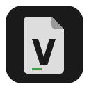
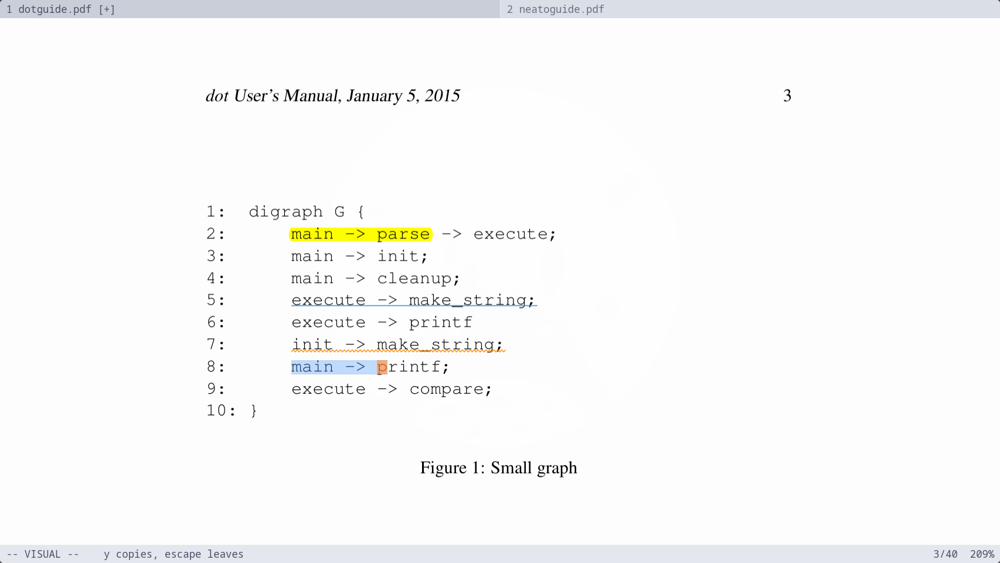
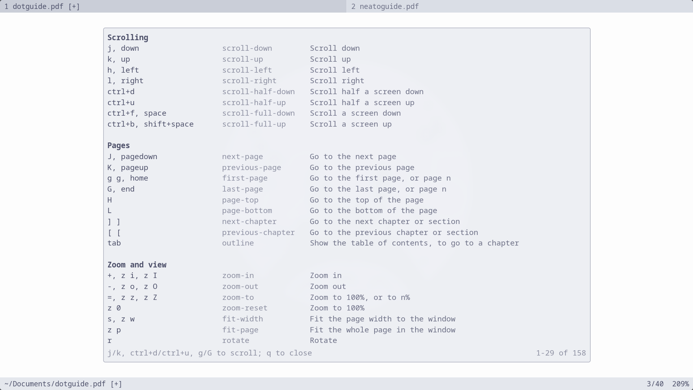

<p align="center"></p>

# pdvim

A PDF reader driven by vi keys. pdvim also opens EPUB and FB2 books, CBZ and CBT comics, XPS documents, SVG drawings and images. It renders pages with [MuPDF](https://mupdf.com/) and draws its window with [iced](https://iced.rs/).


- **Moves and searches like vim:**
  - motions and counts, such as `j`, `12G`, `50%` and `}`;
  - marks and a jump list;
  - `/` with smartcase and matches highlighted as you type;
  - `.` to repeat the last command line.
- **Needs no mouse.** `f` labels every link and form field in view, and typing a label follows the link or fills in the field. A click and a drag work too.
- **Selects text like vim.** `v` starts at a labeled line, and motions and text objects such as `w`, `iw`, `is` and `ip` grow the selection. `I` picks a picture or figure instead.
- **Copies clean text.** It joins the lines of a paragraph, mends words hyphenated across lines, and leaves a blank line between paragraphs. Pictures copy as images.
- **Saves standard annotations.** Highlights, underlines, strike-outs, squiggles, and notes go into the PDF with `:w`, so other readers show them. `u` undoes them.
- **Reads well at night.** It recolors pages to match a dark theme, follows the system's light or dark setting, and can trim blank margins. The four [Catppuccin](https://catppuccin.com) flavors are built in.
- **Finds its way around:**
  - a table of contents, guessed from the text when a PDF has none;
  - `]]` and `[[` to move between chapters;
  - a grid of every page;
  - printed page numbers such as `xii`.
- **Also has:**
  - tabs and sessions;
  - a list of recent documents, each reopened where you stopped;
  - password-protected PDFs and fillable forms;
  - `:!` shell commands, `:export` of a page to PNG or SVG, and of the highlights and notes to Markdown;
  - the manual inside it, with `:man`.

<details>
<summary>More screenshots</summary>

The first page of Alice's Adventures in Wonderland, with two tabs open:


The table of contents, in Catppuccin Mocha, with the page recolored to match:


Labels on each line, to start a selection from:


A highlight, an underline, a squiggly underline, and a selection in progress:



`:help`, listing every key binding in force:



</details>

## Installing

| Platform         | How                                                                                                                                            |
| ---------------- | ---------------------------------------------------------------------------------------------------------------------------------------------- |
| Debian, Ubuntu   | The [package repository](https://djmbritt.github.io/pdvim/), below, or the `.deb` from a [release](https://github.com/djmbritt/pdvim/releases) |
| Fedora, openSUSE | The package repository, below, or the `.rpm` from a release                                                                                    |
| Any Linux        | The `.AppImage`, `.flatpak` or `.tar.gz` from a release, for x86-64 or Arm                                                                     |
| Arch Linux       | `makepkg -si` in [`packaging/`](packaging/)                                                                                                    |
| Nix              | `nix run github:djmbritt/pdvim`, or `nix profile add github:djmbritt/pdvim`                                                                    |
| macOS            | `brew install djmbritt/pdvim/pdvim`, or the `.dmg` from a release                                                                              |
| Windows          | `winget install djmbritt.pdvim`, or the `.zip` from a release                                                                                  |

On Debian and Ubuntu:

```sh
sudo install -d /etc/apt/keyrings
sudo curl -fsSLo /etc/apt/keyrings/pdvim.gpg https://djmbritt.github.io/pdvim/pdvim.gpg
sudo curl -fsSLo /etc/apt/sources.list.d/pdvim.sources https://djmbritt.github.io/pdvim/pdvim.sources
sudo apt update && sudo apt install pdvim
```

On Fedora:

```sh
sudo curl -fsSLo /etc/yum.repos.d/pdvim.repo https://djmbritt.github.io/pdvim/pdvim.repo
sudo dnf install pdvim
```

The packages include the manual pages. `man pdvim` covers the keys and commands, and `man 5 pdvim` covers the configuration file.

To build from source, you need Rust 1.90 or newer, a C toolchain and `libclang`, since MuPDF is compiled too. `nix develop` gives you a shell with all of them.

```sh
cargo build --release    # writes target/release/pdvim
```

## Using it

```sh
pdvim paper.pdf book.epub   # each file opens in a tab of its own
pdvim                       # pick from the documents you read last
```

These are the keys to start with. `:help` lists every key bound right now, and `:help visual` or `:apropos zoom` narrows the list down.

| Key                                         | Action                                                                 |
| ------------------------------------------- | ---------------------------------------------------------------------- |
| `j` `k` `h` `l`, `Ctrl-d` `Ctrl-u`, `Space` | Scroll, by a step, half a screen, or a screen                          |
| `J` / `K`                                   | Next / previous page                                                   |
| `gg` / `G`, `12G`, `50%`                    | First / last page, page 12, halfway through                            |
| `}` / `{`, `]]` / `[[`                      | Next / previous paragraph or chapter                                   |
| `ma`, `` `a ``, `Ctrl-o` / `Ctrl-i`         | Set a mark and go to it, go back / forward through jumps               |
| `Tab`, `go`                                 | Table of contents, every page small                                    |
| `+` / `-`, `zw`, `zp`                       | Zoom in / out, fit the width, fit the page                             |
| `R`, `t`, `zc`, `zm`                        | Recolor, trim margins, columns, page mode                              |
| `/` / `?`, `n` / `N`, `g /`                 | Search, next / previous match, list every match                        |
| `f`, `F`, `gi`                              | Follow a link or fill in a field, open in a new tab, first field       |
| `v` / `V`, `s`                              | Select characters / lines from a label, or put a cursor at typed text  |
| `y`, `yp`, `yi`                             | Copy the selection, the page's text, a picture                         |
| `H` `U` `S` `W`, `n`                        | In visual mode: highlight, underline, strike out, squiggle; add a note |
| `]h` / `[h`, `Shift-Tab`, `u` / `Ctrl-r`    | Next / previous marking, list them, undo / redo                        |
| `gt` / `gT`, `b`, `o`                       | Next / previous tab, list tabs, recent documents                       |
| `:`, `.`, `Esc`, `q`                        | Command line, repeat it, cancel, close the tab                         |

As in vi, a count repeats a key: `3j` scrolls three steps. Markings stay out of the file until you save with `:w` or `Ctrl-s`. Until then the tab shows `[+]`, and pdvim asks before closing it. The box at the left of the status bar names the mode, and the bar lists the keys you can press next.

| Command                                   | Action                                                             |
| ----------------------------------------- | ------------------------------------------------------------------ |
| `:{n}`, `:{n}%`, `:goto xii`              | Go to page _n_, _n_% of the way through, or the page printed `xii` |
| `:o {file}`, `:recent`                    | Open a document in a new tab, show the recent ones                 |
| `:w`, `:w {file}`, `:q`, `:wq`, `:q!`     | Save, save a copy, close, both, close without saving               |
| `:set {setting} {value}`, `:theme {name}` | Change a setting or the theme                                      |
| `:map`, `:unmap`, `:mapclear`             | Change key bindings while running                                  |
| `:export {file}`                          | Save the page as `.png` or `.svg`, or the markings as `.md`        |
| `:!{command}`                             | Run a shell command, with `%` for the file and `$PDVIM_*` for more |
| `:info`, `:marks`, `:note {text}`         | Document details, marks, a note on the window                      |
| `:help [topic]`, `:man [5]`               | The keys, the manual                                               |

Every action can also be run by name, such as `:zoom-to 150`, and `;` separates commands on one line.

Books have no pages of their own, so pdvim lays them out to fit the window in the type size set by `fontsize`, and the zoom keys change the type size. Search, copying, links, contents and visual mode work in every format with text. Markings, forms and `:w` work in PDFs only.

## Configuration

pdvim reads `~/.config/pdvim/config.toml`, or that path under `$XDG_CONFIG_HOME`. The file is optional, and `:source` reads it again after you edit it. [`defaults.toml`](defaults.toml) lists every setting and every binding of every mode, with comments, and `man 5 pdvim` describes them. A short file is enough, since anything left out keeps its default:

```toml
[settings]
recolor = true                  # or false, or "auto" to follow the system
theme = "catppuccin-macchiato"
columns = 2                     # pages side by side, 1 to 4

[keys.normal]
"ctrl+n" = "next-tab"
"ctrl+t" = ":theme catppuccin-latte"   # a command line
"q" = "none"                           # unbind a default

# Scans stay as printed, and trimmed.
[[paths]]
match = "~/scans/**"
recolor = false
trim = true
```

Keys are written as characters or names, such as `j`, `space`, `pageup`, `ctrl+d` or `shift+tab`. A sequence is written with spaces between its keys, as in `"g g"`, and `leader` in one stands for the key the `leader` setting names, `\` unless you set another. A `[[paths]]` pattern without a `/` matches the file's name, and when several match, the last one wins. If an entry has a mistake, pdvim skips it and says so in the status bar.

|                 | Linux                                 | macOS                  | Windows                |
| --------------- | ------------------------------------- | ---------------------- | ---------------------- |
| Configuration   | `~/.config/pdvim/config.toml`         | `~/.config/pdvim`      | `%APPDATA%\pdvim`      |
| Reading history | `~/.local/share/pdvim/history.sqlite` | `~/.local/share/pdvim` | `%LOCALAPPDATA%\pdvim` |

Your own keys can hand the document to scripts. A command run with `:!` finds where you are in its environment: `$PDVIM_FILE`, `$PDVIM_PAGE`, `$PDVIM_PAGES`, `$PDVIM_PAGE_LABEL`, `$PDVIM_TITLE`, `$PDVIM_SELECTION` (the text selected, or last selected) and `$PDVIM_SEARCH`. pdvim shows the last line the command prints:

```toml
[settings]
leader = ","

[keys.normal]
"leader d" = ':!sdcv -n "$PDVIM_SELECTION" | tail -1'           # look up the word selected
"leader z" = ':!zotero-add "$PDVIM_FILE"'                       # hand the file to a script
"leader c" = ':!echo "$PDVIM_TITLE, p. $PDVIM_PAGE" | wl-copy'  # copy a citation
```

The history keeps each document's place, zoom and marks, your command history, and the tabs open when you last quit. The Flatpak keeps its history in `~/.var/app/io.github.djmbritt.pdvim`.

## Developing

```sh
cargo test                  # every test
./coverage.sh               # how much of src/ the tests reach
cargo mutants --file src/layout.rs   # what changes to the code they miss
fuzz/run.sh pdf 600         # fuzz PDF loading for ten minutes
cargo bench                 # time the work done on each frame and key
```

- **Tests.** The tests include:
  - units of each part;
  - the app driven with real PDFs from `fuzz/seeds/`, with every default key pressed and every command run;
  - the window drawn in each of its states with tiny-skia, needing no screen;
  - in `src/languages.rs`, selecting, copying, searching and moving the cursor through samples in sixteen languages, from English to Arabic, Hindi, Chinese and Thai.

  `fuzz/languages/make-pdfs.sh` rebuilds the language samples' PDFs.

- **Coverage.** `coverage.sh` needs `rustup component add llvm-tools-preview`, and leaves a browsable report in `target/coverage/html/`. The tests reach 91% of the lines. `main.rs` and `clipboard.rs` are left out, since no test can run them. CI fails under 90%, set as `COVERAGE_FLOOR` in `.github/workflows/coverage.yml`, and `./coverage.sh --fail-under 90` checks the same.
- **Mutation testing.** [cargo-mutants](https://mutants.rs/) changes the code one small way at a time and lists the changes no test notices in `mutants.out/missed.txt`. A run over all the code takes many hours, so run it a file at a time. Its settings are in `.cargo/mutants.toml`. CI runs it over the lines each pull request changes.
- **Fuzzing.** `fuzz/` has [cargo-fuzz](https://github.com/rust-fuzz/cargo-fuzz) targets for everything read from outside: documents, the configuration, commands and keys. CI fuzzes each target after every push to `main`, and for longer once a week. See [fuzz/README.md](fuzz/README.md).
- **Benchmarks.** `benches/hot_paths.rs` uses [criterion](https://github.com/criterion-rs/criterion.rs). It times rendering and recoloring a page, searching its text, flash jumps, finding sentences and paragraphs, and laying out 10,000 pages. Reports are in `target/criterion/report/`.

## License

[AGPL-3.0-or-later](https://www.gnu.org/licenses/agpl-3.0.html)
