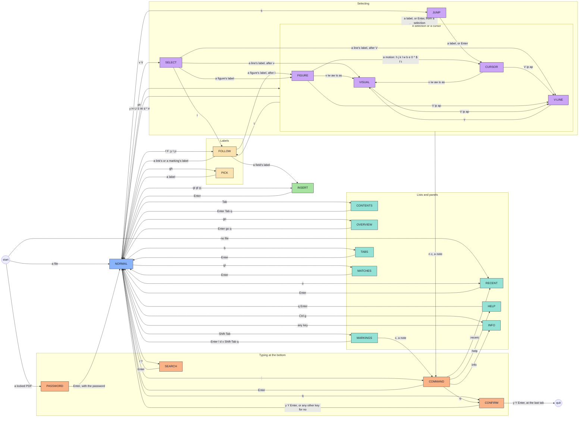

# Modes and the keys between them

Every way from one mode to another with the default key bindings. Each mode is named as the box at the left of the status bar names it, and colored as that box is. The paths were found by pressing every bound key in every mode, with the documents in `fuzz/seeds/pdf/`.

`Esc`, `Ctrl-c` and `Ctrl-[` cancel every mode, and are left out of the diagram. `Backspace` also cancels a prompt or label you haven't typed into yet. Keys that keep you in the same mode are also left out, such as scrolling, or `Tab` from one form field to the next. `:help` lists those.

## Every path, mode by mode

| From | Keys | To |
| --- | --- | --- |
| NORMAL | `:` | COMMAND |
| | `/`, `?` | SEARCH |
| | `q`, or `:q` | CONFIRM |
| | `Tab` | CONTENTS, when the document has a table of contents |
| | `go` | OVERVIEW |
| | `Shift-Tab` | MARKINGS |
| | `o` | RECENT |
| | `b` | TABS |
| | `g/` | MATCHES, after a search that found something |
| | `Ctrl-g` | INFO |
| | `f`, `F`, `;y`, `I`, `yi` | FOLLOW, when there is something in view to label |
| | `gh` | PICK, when there are markings in view |
| | `gi`, `gI`, `g;` | INSERT, in a form |
| | `v`, `V` | SELECT |
| | `s` | JUMP |
| | `gv` | VISUAL or V-LINE, after an earlier selection |
| COMMAND | `Enter` | NORMAL, or what the command opens: `:help` HELP, `:recent` RECENT, `:info` INFO, `:q` CONFIRM |
| SEARCH | `Enter` | NORMAL |
| PASSWORD | `Enter`, with the right password | NORMAL |
| CONFIRM | `y`, `Y`, `Enter` | NORMAL, or quit at the last tab |
| | any other key | NORMAL |
| CONTENTS | `Enter`, `Tab`, `q` | NORMAL |
| OVERVIEW | `Enter`, `go`, `q` | NORMAL |
| MARKINGS | `Enter`, `l`, `d`, `x`, `Shift-Tab`, `q` | NORMAL |
| | `c` | COMMAND, to change the note |
| HELP | `q`, `Enter` | NORMAL |
| RECENT, TABS, MATCHES | `Enter` | NORMAL |
| INFO | any key | NORMAL |
| FOLLOW | a link's or a marking's label, or a figure's after `yi` | NORMAL |
| | a field's label | INSERT |
| | a figure's label, after `I` | FIGURE |
| PICK | a label | NORMAL |
| INSERT | `Enter` | NORMAL |
| SELECT | a line's label | VISUAL after `v`, V-LINE after `V` |
| | a figure's label | FIGURE |
| | `I` | FOLLOW |
| JUMP | a label, or `Enter` for the nearest | CURSOR, or back to the selection it was started from |
| VISUAL | `V`, `ip`, `ap` | V-LINE |
| V-LINE | `v` | VISUAL |
| CURSOR, FIGURE | `v`, `iw`, `aw`, `is`, `as` | VISUAL |
| | `V`, `ip`, `ap` | V-LINE |
| FIGURE | a motion: `h` `j` `k` `l`, `w` `b` `e`, `0` `^` `$`, `f` `F` `t` `T` `;` `,` | CURSOR |
| VISUAL, V-LINE, CURSOR, FIGURE | `y`, `H`, `U`, `S`, `W`, `d` | NORMAL, after copying or marking |
| | `*`, `#` | NORMAL, at the next match |
| | `v` in VISUAL, `V` in V-LINE | NORMAL |
| | `n`, `c` | COMMAND, to write a note |
| | `s` | JUMP |
| | `I` | FOLLOW |
